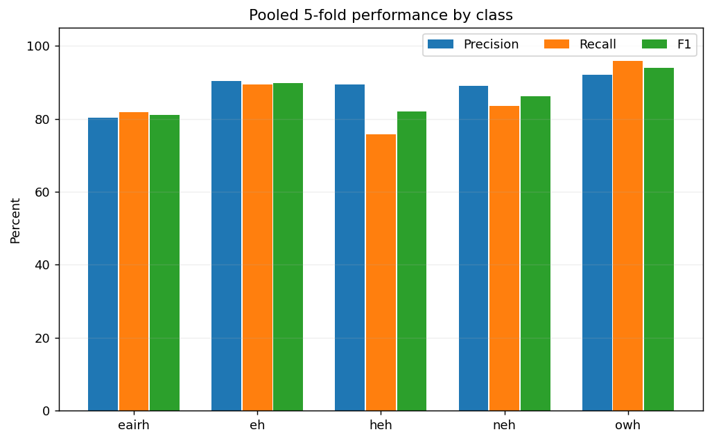
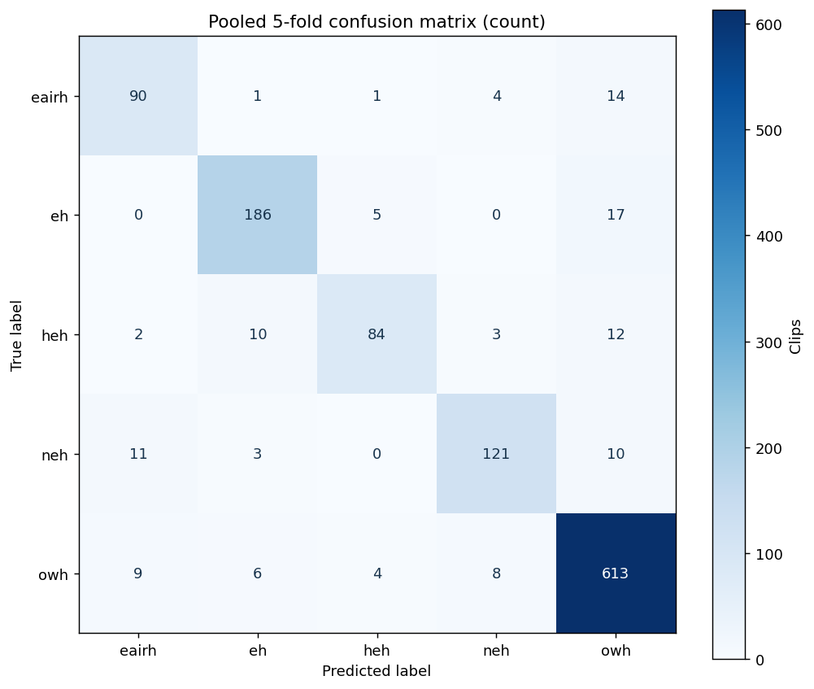
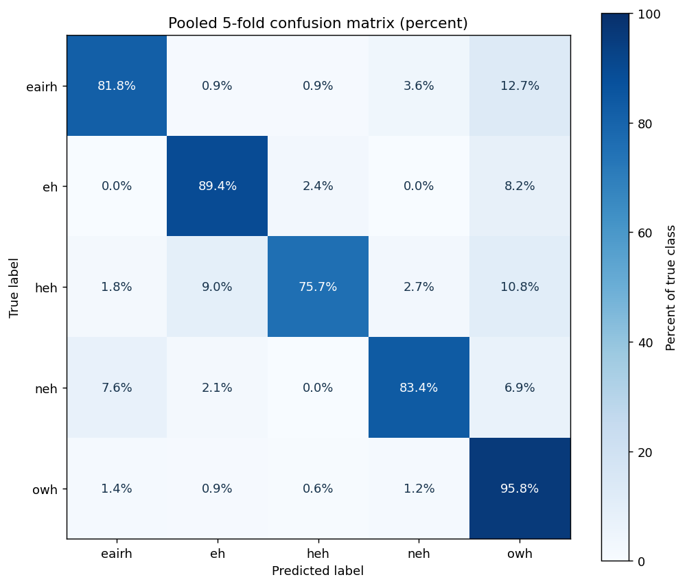
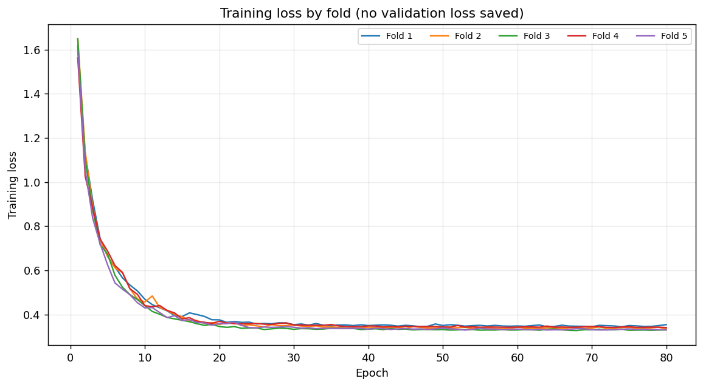

# รายงานผล Benchmark ครั้งที่ 1: Sinc-Mamba-KAN แบบพัฒนาตามบทความ

**Run ID:** `20261116T193124Z_05d86d55d2`  
**ชุดข้อมูล:** InfantCry-1214, 5 คลาส  
**การประเมิน:** 5-fold cross-validation ภายในชุดข้อมูล  
**สถานะ:** ฝึกและมีผลครบ 5 folds; ตรวจสอบความสอดคล้องของไฟล์ผลแล้วตามขอบเขตในหัวข้อ 10

> **ข้อสำคัญ:** โมเดลนี้เป็นโค้ดที่พัฒนาขึ้นตามคำอธิบายของบทความ ไม่ใช่ source code ของผู้เขียน Feature 213 ค่าและรายละเอียดบางส่วนเป็น proxy หรือข้อสมมติ ผลนี้จึงไม่ใช่การทำซ้ำที่ยืนยันว่าเหมือนบทความทุกขั้นตอน และยังไม่ใช่การทดสอบด้วยข้อมูลภายนอก

## 1. สรุปสำหรับอ่านเร็ว

จากคลิป **1,214 รายการ** โมเดลถูกฝึกและประเมิน 5 รอบ แต่ละรอบกันคลิปหนึ่งส่วนเป็น held-out fold และใช้ส่วนอื่นฝึก เมื่อเฉลี่ยผลของทั้ง 5 folds ได้:

| ตัวชี้วัด | ค่าเฉลี่ย ± ส่วนเบี่ยงเบนมาตรฐานระหว่าง folds | ตอบคำถามอะไร |
|---|---:|---|
| Accuracy | **90.12% ± 1.28 จุดเปอร์เซ็นต์** | โดยรวมจำแนกถูกกี่เปอร์เซ็นต์ |
| Balanced Accuracy | **85.44% ± 1.87 จุด** | เมื่อเฉลี่ย recall ของ 5 คลาสเท่ากัน ได้เท่าไร |
| Macro F1 | **86.34% ± 1.40 จุด** | ค่าเฉลี่ย F1 ที่ให้แต่ละคลาสมีน้ำหนักเท่ากัน |
| Macro AUC, one-vs-rest | **97.14% ± 0.96 จุด** | คะแนนโมเดลช่วยจัดอันดับคลาสเป้าหมายเทียบกับคลาสอื่นได้ดีเพียงใด |

ค่า ± เป็น **ส่วนเบี่ยงเบนมาตรฐานของคะแนน 5 folds** ไม่ใช่ช่วงความเชื่อมั่น และ folds ไม่ใช่การทดลองอิสระ 5 ชุด ผลจำแนกเป็นการเทียบกับ label ใน dataset ไม่ใช่การยืนยันอาการทางการแพทย์

## 2. โมเดลนี้ทำอะไร

โมเดลรับเสียงคลิปหนึ่งและทำนายหนึ่งในห้าป้ายกำกับ DBL:

| ชื่อ DBL | ชื่อที่ใช้ในโครงการ INFANT CRY | ความหมายที่ใช้เรียกใน dataset |
|---|---|---|
| `eairh` | `belly_pain` | กลุ่มเสียงที่สัมพันธ์กับลมในท้อง/ไม่สบายท้องตามกรอบ DBL |
| `eh` | `burping` | กลุ่มเสียงที่สัมพันธ์กับการเรอ |
| `heh` | `discomfort` | กลุ่มเสียงที่สัมพันธ์กับความไม่สบายตัว |
| `neh` | `hungry` | กลุ่มเสียงที่สัมพันธ์กับความหิว |
| `owh` | `tired` | กลุ่มเสียงที่สัมพันธ์กับความง่วง |

ชื่ออาการในตารางเป็นการจับคู่ชื่อคลาสเพื่ออ่านผล ไม่ใช่หลักฐานว่าโมเดลวินิจฉัยสาเหตุจริงของการร้องได้

### ลำดับการทำงานโดยย่อ

1. โหลดเสียงเป็น mono, แปลงเป็น **16,000 Hz**, ตัดหรือเติมศูนย์เป็น **2 วินาที หรือ 32,000 samples** และปรับระดับ peak; การตัดจากต้นคลิปและเติมศูนย์ท้ายคลิปเป็นข้อสมมติของ implementation นี้
2. แยกเป็นสองแขนง: แขนง waveform ใช้ **SincConv → CNN → Mamba** และแขนงคุณลักษณะใช้ **feature proxy 213 ค่า → StandardScaler → เลือก 100 ค่าด้วย mutual information → projection**
3. รวมเวกเตอร์จากสองแขนง แล้วจำแนก 5 คลาสด้วยหัว **Gaussian RBF-KAN proxy**
4. ในแต่ละ fold คำนวณ scaler และเลือก feature จากข้อมูลฝึกของ fold นั้นเท่านั้น ส่วน held-out fold ใช้ค่าสถิติที่ได้จากฝั่งฝึก

อ้างอิงการออกแบบและข้อที่ไม่ตรงหรือยังยืนยันไม่ได้จาก [เอกสารวิธีในบทความ](../../docs/paper_methods_th.md), [ค่าที่รันจริง](../../runs/20261116T193124Z_05d86d55d2/config.json) และบทความ [Sinc-Mamba-KAN, DOI 10.1109/ACCESS.2026.3733522](https://doi.org/10.1109/ACCESS.2026.3733522)

## 3. ข้อมูลและการแบ่ง 5 folds

| คลาส | จำนวนคลิปใน benchmark | สัดส่วน |
|---|---:|---:|
| `eairh` | 110 | 9.06% |
| `eh` | 208 | 17.13% |
| `heh` | 111 | 9.14% |
| `neh` | 145 | 11.94% |
| `owh` | 640 | 52.72% |
| **รวม** | **1,214** | **100%** |

คลาส `owh` มีมากกว่าครึ่งของข้อมูล จึงไม่ควรดู Accuracy อย่างเดียว ควรดู Balanced Accuracy, Macro F1 และผลรายคลาสร่วมด้วย

แต่ละรอบแบ่งกลุ่มด้วย SHA-256 ของไฟล์ทั้งไฟล์: ไฟล์ที่ bytes ตรงกันอยู่กลุ่มเดียวกันและไม่ข้ามฝั่งฝึก/ประเมินภายใน fold เดียวกัน ผลแต่ละ fold ใช้คลิปที่กันไว้ 241–245 รายการ และผลตรวจพบว่าคลิปทั้ง 1,214 รายการปรากฏใน held-out fold **คนละหนึ่งครั้ง**

SHA-256 ตรวจพบเฉพาะไฟล์ที่ bytes ตรงกัน ไม่ยืนยันว่าเสียงที่แปลง encoding หรือบันทึกจากทารกคนเดียวกันถูกจัดอยู่กลุ่มเดียวกัน ผลนี้จึง **ยังไม่ใช่ infant-disjoint validation** ดูแนวคิดการแบ่งกลุ่มใน [เอกสาร cross-validation ของ scikit-learn](https://scikit-learn.org/stable/modules/cross_validation.html)

## 4. ผลของแต่ละ fold

| Fold | คลิปฝึก | คลิปประเมิน | Accuracy | Balanced Accuracy | Macro F1 | Macro AUC |
|---:|---:|---:|---:|---:|---:|---:|
| 1 | 973 | 241 | 87.97% | 84.27% | 85.04% | 97.54% |
| 2 | 972 | 242 | 91.32% | 83.69% | 85.75% | 96.98% |
| 3 | 969 | 245 | 89.39% | 88.07% | 85.30% | 98.01% |
| 4 | 973 | 241 | 91.29% | 87.33% | 88.91% | 95.34% |
| 5 | 969 | 245 | 90.61% | 83.84% | 86.69% | 97.82% |

ทั้ง 5 folds มีประวัติ **80 epochs** และมี model, split, feature transform, predictions และ metrics แยกไว้ครบ ผลแต่ละ fold ต่างกันได้ตามคลิปที่ถูกกันไว้ แต่เพียง 5 folds และ 1 seed ยังไม่พอใช้ยืนยันความเสถียรทั่วไป

### ค่าเฉลี่ย fold กับ pooled OOF ต่างกันอย่างไร

- **Fold mean:** คำนวณ metric แยก 5 ครั้ง แล้วเฉลี่ย 5 ค่า — เป็นตัวเลขหลักในหัวข้อ 1
- **Pooled OOF:** รวมคำทำนาย held-out ของทั้ง 5 folds ให้ครบ 1,214 รายการ แล้วคำนวณ metric อีกครั้ง

| ตัวชี้วัด | Fold mean | Pooled OOF |
|---|---:|---:|
| Accuracy | 90.12% | 90.12% (1,094 / 1,214) |
| Balanced Accuracy | 85.44% | 85.23% |
| Macro F1 | 86.34% | 86.58% |
| Macro AUC | 97.14% | 97.01% |

ค่าไม่จำเป็นต้องเท่ากัน เพราะขนาดและองค์ประกอบของแต่ละ fold ต่างกัน และ metric บางตัวไม่สามารถเฉลี่ยจากผลย่อยให้เท่าการคำนวณจากข้อมูลรวมได้

## 5. ผลรายคลาส — Pooled OOF

| คลาสจริง | จำนวน | Precision | Recall | F1 |
|---|---:|---:|---:|---:|
| `eairh` | 110 | 80.36% | 81.82% | 81.08% |
| `eh` | 208 | 90.29% | 89.42% | 89.86% |
| `heh` | 111 | 89.36% | **75.68%** | 81.95% |
| `neh` | 145 | 88.97% | 83.45% | 86.12% |
| `owh` | 640 | 92.04% | 95.78% | 93.87% |

- **Precision:** ในคลิปที่โมเดลทำนายว่าเป็นคลาสนั้น มีถูกกี่เปอร์เซ็นต์
- **Recall:** ในคลิปที่เป็นคลาสนั้นจริง โมเดลหาเจอกี่เปอร์เซ็นต์
- **F1:** ค่าที่สรุปความสมดุลระหว่าง Precision และ Recall

`heh` มี Recall ต่ำสุด: จาก 111 คลิป ทำนายถูก 84 คลิป จึงเป็นคลาสที่ควรตรวจรายละเอียดต่อ ขณะที่ `owh` มี Recall สูงสุด แต่ก็เป็นคลาสที่มีข้อมูลมากที่สุด ไม่สามารถสรุปจากผลนี้เพียงอย่างเดียวว่าจำนวนข้อมูลเป็นสาเหตุของความต่าง

## 6. Confusion matrix: โมเดลสับสนตรงไหน

ในภาพ **แถวคือ label จริง คอลัมน์คือ label ที่ทำนาย** ช่องแนวทแยงคือทำนายถูก ตัวเลขนอกแนวทแยงคือทำนายผิด รวมคำทำนายจาก held-out ทั้ง 5 folds ไม่ใช่ Final Test แยกต่างหาก

ตัวอย่างการอ่าน:

- `eairh` จริง 110 คลิป: ถูก 90 คลิป และทำนายเป็น `owh` 14 คลิป
- `heh` จริง 111 คลิป: ถูก 84 คลิป ทำนายเป็น `eh` 10 และ `owh` 12 คลิป
- `neh` จริง 145 คลิป: ถูก 121 คลิป และทำนายเป็น `eairh` 11 คลิป

ภาพต่อไปหารด้วยจำนวนคลิปของแต่ละแถว จึงอ่านเป็นสัดส่วนภายในคลาสจริงได้ง่ายขึ้น:

## 7. Training loss

กราฟแสดง **training loss เท่านั้น** แต่ละเส้นลดลงในช่วงต้นและเปลี่ยนแปลงน้อยลงภายหลัง ตัวเลข loss มีองค์ประกอบจาก weighted cross-entropy, label smoothing และ polynomial term ตามโค้ดที่รัน ไม่ใช่เปอร์เซ็นต์ความถูกต้อง

**ไม่มี validation loss ที่บันทึกระหว่าง epochs** จึงใช้กราฟนี้เพียงอย่างเดียวสรุปไม่ได้ว่าไม่มี overfitting หรือควรหยุดฝึกที่ epoch ใด ค่า 80 ถูกกำหนดล่วงหน้า และไม่ได้ใช้ held-out fold เลือก epoch

## 8. เทียบเบื้องต้นกับ Stage 2 ของ INFANT CRY

เปรียบเทียบ **ค่าเฉลี่ย 5 folds** จากผลที่มีอยู่ ไม่ใช่ผลจากการทดลองด้วย folds เดียวกัน:

| ตัวชี้วัด | Stage 2 โมเดลหลัก | Benchmark นี้ | ส่วนต่างตัวเลข |
|---|---:|---:|---:|
| Accuracy | 91.10% | 90.12% | หลัก +0.99 จุดเปอร์เซ็นต์ |
| Balanced Accuracy | 88.46% | 85.44% | หลัก +3.02 จุด |
| Macro F1 | 88.63% | 86.34% | หลัก +2.29 จุด |
| Macro AUC | 97.71% | 97.14% | หลัก +0.57 จุด |

**ห้ามตีความตารางนี้ว่าโมเดลหลักชนะอย่างยุติธรรมหรือมีนัยสำคัญทางสถิติ:** โมเดลหลักประเมินบนข้อมูลพัฒนา 1,045 records ขณะที่ benchmark ใช้ 1,214 คลิป วิธีคัดข้อมูลซ้ำและ fold assignment ต่างกัน อีกทั้ง benchmark เป็น implementation แบบประมาณจากบทความ

ข้อมูลโมเดลหลัก: [OOF metrics](<../../../INFANT CRY/Models_dbl/Main/runs/20260821T164332Z_490383ff/oof_metrics.json>) และ [รายงานโมเดลหลัก](<../../../INFANT CRY/Report/runs/report_01_20260821.md>) หากเปิดลิงก์ข้ามไดรฟ์/โปรเจกต์ไม่ได้ ให้เปิดจาก `D:\INFANT CRY` โดยตรง

### การทับซ้อนที่ต้องระวัง

ตรวจเทียบ SHA-256 ระหว่าง benchmark กับระเบียน `eligible` ที่บันทึกใน run ของโมเดลหลัก:

- **917 จาก 1,045** records ใน OOF/development ของโมเดลหลัก มี hash ตรงกับคลิปใน benchmark; label ที่แมปแล้วตรงกันสำหรับ records ที่พบ
- อีก **128 records** ที่ไม่พบใน benchmark Tier 2 มีชื่อไฟล์ขึ้นต้น `dunstan-` และ hash พร้อม label ที่แมปแล้วตรงกับไฟล์ในโฟลเดอร์ `dunstan  337` ของ dataset ที่มีอยู่ครบทั้ง 128 records การจับคู่เป็นหลักฐานระดับ bytes และ label ไม่ใช่การยืนยันตัวตนทารกหรือ provenance ทั้งหมด
- **275 จาก 303** records ใน Final Test ของโมเดลหลัก มี hash ตรงกับคลิปในชุด cross-validation ของ benchmark; label ที่แมปแล้วตรงกันสำหรับ records ที่พบ

Benchmark ใช้ข้อมูลทั้ง 1,214 คลิปหมุนเวียนเป็น held-out ครั้งละหนึ่ง fold ดังนั้นกลุ่มคลิปที่ตรงกับ Final Test เดิมถูกนำไปใช้ในฝั่งฝึกของ benchmark ใน folds อื่นด้วย **ห้ามนำ Final Test เดิมไปอ้างว่าเป็นข้อมูลใหม่ที่ไม่เคยใช้กับ benchmark** การตรวจ hash นี้เป็นการตรวจ byte-for-byte เท่านั้น

## 9. ข้อแตกต่างจากบทความและข้อจำกัด

| ประเด็น | สถานะของ run นี้ |
|---|---|
| Source code ผู้เขียน | ยังไม่พบที่ยืนยันได้; ใช้โค้ดที่พัฒนาขึ้นเองจากคำอธิบายในบทความ |
| 213 acoustic features | เป็น schema **proxy** ที่ระบุชื่อได้ครบ 213 ค่า แต่ไม่ยืนยันว่าตรงสูตร/ลำดับของผู้เขียน |
| KAN | ใช้ Gaussian RBF proxy; ยังไม่ยืนยัน basis และ implementation เดิม |
| Augmentation | waveform noise `0.005`, shift สูงสุด `1,600` samples และ feature noise `0.01` เป็นข้อสมมติ |
| Loss | ใช้ polynomial epsilon `1.0` เป็นข้อสมมติ, label smoothing `0.05` |
| Dataset | รายงานนี้ใช้ InfantCry-1214 เท่านั้น ไม่รวม Dunstan-Core ใน run เดียวกัน |
| Label และข้อมูลซ้ำ | audit ของ dataset รวมพบ **180 กลุ่ม hash ซ้ำข้าม tier** ในจำนวนนี้ 3 กลุ่ม label ขัดแย้ง และมี suffix/parent label ไม่ตรง 1 รายการใน tier ที่ใช้; run ใช้ label จาก metadata/โฟลเดอร์และไม่เปลี่ยน label |
| สถานะ audit | ไฟล์ audit เดิมระบุ `basic_integrity_pass: false` จากข้อขัดแย้งที่พบ; การคำนวณผลครบไม่ได้หมายความว่าปัญหา label เหล่านี้ถูกแก้แล้ว |
| ตัวบุคคล/เซสชัน | ยังไม่พิสูจน์ infant ID; การกัน hash ซ้ำไม่เท่ากับกันเสียงจากทารกคนเดียวกัน |
| Final model | run นี้เก็บ **5 โมเดลของ 5 folds** ยังไม่มี final-refit model หรือชุด external test |

หากต้องการเปรียบเทียบตัวเลขกับบทความ ต้องอธิบายความต่างด้าน dataset, split, features, hyperparameters และ implementation ทุกข้อ ไม่ควรนำเปอร์เซ็นต์มาตัดสินว่าชนะหรือแพ้โดยตรง

## 10. ขอบเขตการตรวจสอบรายงานนี้

ตรวจจากไฟล์ run โดย **ไม่ฝึก ไม่รัน inference ซ้ำ และไม่แก้ไฟล์ต้นฉบับ**:

1. ตรวจว่าทั้ง 5 folds มีไฟล์ model, feature transform, split, history, predictions และ metrics ที่ไม่ว่าง และ history มี 80 epochs ตามลำดับ
2. คำนวณ metrics และ confusion matrix ใหม่จาก `predictions.csv` และเปรียบเทียบกับ `metrics.json` กับ `summary.json` — ผลสอดคล้องภายใน tolerance ของโปรแกรม
3. ตรวจ train/held-out เป็น partition ครบ ไม่ซ้ำ index, ไม่มี hash ข้ามฝั่งในแต่ละ fold, label/probability ตรงกัน และ held-out รวมครบ 1,214 indices ครั้งละหนึ่งครั้ง
4. อ่านไฟล์เสียงจริงและคำนวณ SHA-256 ใหม่: **1,214 จาก 1,214 ไฟล์ตรงกับ hash ที่บันทึกใน `records.json`**; hash ของ 14 source files ที่ระบุใน config ตรงกับไฟล์ปัจจุบัน

ข้อจำกัด: run ไม่ได้บันทึก manifest hash ที่เป็นอิสระสำหรับ model weights หรือ feature-transform artifacts และไม่ได้สร้างคำทำนายใหม่จากไฟล์โมเดล การตรวจนี้จึงยืนยัน **ความสอดคล้องของหลักฐานที่มี** ไม่ได้พิสูจน์ความถูกต้องของน้ำหนักหรือการฝึกย้อนหลังทุกขั้นตอน ดู [ผลตรวจละเอียด](verification.json)

## 11. ขั้นตอนถัดไปที่แนะนำ

รายละเอียดและเกณฑ์ตรวจสอบก่อนเทรนรอบเปรียบเทียบอยู่ใน [แผนเทียบด้วยข้อมูลและ fold เดียวกัน](../../docs/PAIRED_COMPARISON_PLAN.md)

1. ให้ทีมและอาจารย์ตรวจรายงานนี้ โดยเฉพาะข้อสมมติ ข้อมูลซ้ำ และการทับซ้อนกับ Final Test เดิม
2. หากต้องการเทียบกับ `INFANT CRY` อย่างเป็นธรรม ให้กำหนด protocol ก่อนฝึก: ใช้ records, labels, นโยบายข้อมูลซ้ำ และ fold assignment ชุดเดียวกันทั้งสองวิธี
3. จัดทำ manifest ชุดเปรียบเทียบจาก `fold_assignments.csv` ของโมเดลหลัก โดยยืนยัน 917 records ที่ตรง Tier 2 และ 128 records ที่ตรงโฟลเดอร์ Dunstan-Core พร้อมตรวจ hash, label และ fold อีกครั้งก่อนใช้ ห้ามเพิ่ม/เปลี่ยน label เองเพื่อให้คะแนนดีขึ้น ชุด 1,045 records นี้เป็น **ชุดผสมสอง tier สำหรับเทียบกับโมเดลหลัก** ไม่ใช่การทำซ้ำผล InfantCry-1214 ล้วน
4. หากได้รับอนุมัติ protocol ให้เตรียมโค้ด benchmark สำหรับใช้ manifest และ fold ที่ตรึงไว้ โดยไม่ใช้ 303 records ของ Final Test เดิมในการฝึก/เลือก แล้วให้ **ผู้ใช้เป็นผู้เริ่มเทรนเอง** เปรียบเทียบแบบ paired บน OOF predictions เดียวกัน รายงาน preprocessing และ training recipe ที่ต่างกัน
5. หากต้องการข้อสรุปยืนยัน ควรมีข้อมูลทดสอบที่ยังไม่ถูกใช้พัฒนาหรือเลือกโมเดล และมี subject/session identifiers ที่ตรวจสอบได้เมื่อจะกล่าวถึงทารกคนใหม่ ผลชุดที่เคยใช้เลือกแนวทางควรระบุว่าเป็น exploratory

## 12. ไฟล์ที่เกี่ยวข้อง

- [ผลเฉลี่ย 5 folds ต้นฉบับ](../../runs/20261116T193124Z_05d86d55d2/summary.json)
- [ตัวอย่างผลราย fold — fold 1](../../runs/20261116T193124Z_05d86d55d2/fold_1/metrics.json)
- [บันทึก dataset audit ขณะรัน](../../runs/20261116T193124Z_05d86d55d2/data_audit.json)
- [การตั้งค่าและ source hashes ขณะรัน](../../runs/20261116T193124Z_05d86d55d2/config.json)
- [สถานะและวิธีรันโครงการ](../../docs/training_implementation_status.md)
- แหล่งชุดข้อมูล: [InfantCry-DBL Version 1](https://data.mendeley.com/datasets/x493z8nmwc/1)
- นิยาม metrics: [scikit-learn: Metrics and scoring](https://scikit-learn.org/stable/modules/model_evaluation.html)
